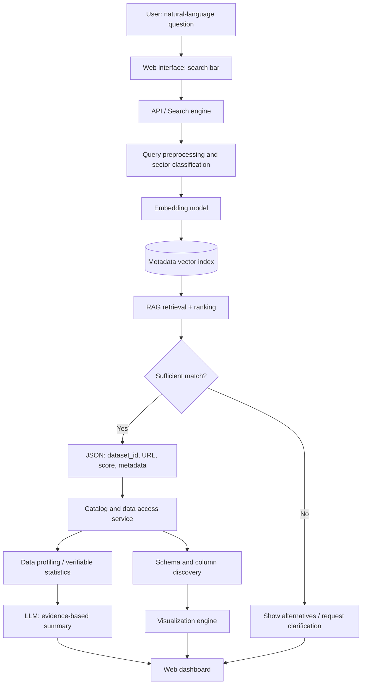

# Semantic Data Discovery & Interactive Dashboards

> **Status:** Architecture proposal · **Version:** 0.1.0 (planning)

A web application that turns natural-language questions into **dataset discovery**, **evidence-based summaries**, and **interactive visualizations**. At its core is a semantic search engine powered by embeddings and retrieval-augmented generation (RAG), which identifies the most relevant dataset from a metadata catalog.

## 1. Overview

Users enter a question in a search bar. The system interprets the intent, searches a semantic index of dataset descriptions, and returns a JSON object containing the recommended dataset's URL and metadata. This result enables two capabilities: an LLM-generated summary and a chart builder for selecting columns and creating visualizations. The web interface brings the entire workflow together.

### Main objective

Make data exploration accessible without requiring users to know the names, locations, or schemas of available data sources beforehand.

### MVP scope

- Search for datasets using natural language.
- Retrieve and rank results using semantic similarity.
- Return structured JSON identifying the recommended dataset.
- Summarize **verifiable metadata** and, when data is accessible, **statistics computed from the dataset**.
- Inspect columns and create interactive charts.
- Display results in a unified web application.

### Out of scope for the initial release

- Fully automated generation of complex, multi-source dashboards.
- Arbitrary joins across datasets.
- Unrestricted SQL queries generated and executed by the LLM.
- Training or fine-tuning foundation models.

## 2. Proposed Architecture



> **Note:** RAG retrieves **descriptions and metadata** to identify sources; it does not replace reading the actual dataset. Statistical summaries and charts require querying the underlying data through controlled connectors.

### Components

| Component | Responsibility |
|---|---|
| Frontend | Search, results, summaries, and interactive dashboards |
| Backend API | Orchestrates services and exposes endpoints |
| Data catalog | Stores identifiers, URLs, descriptions, sectors, schemas, and permissions |
| Sector classification engine | Classifies query intent, domain, and potential filters |
| Embedding service | Converts queries and descriptions into comparable vectors |
| Vector store | Indexes dataset embeddings |
| RAG retriever | Retrieves and ranks candidates; optionally uses a reranker |
| Data connectors | Access CSV, Parquet, APIs, or SQL databases with restricted permissions |
| Data profiling service | Computes statistics and validates types, missing values, units, and ranges |
| LLM service | Produces summaries based on metadata and observed facts |
| Chart engine | Validates columns and provides charts suited to their data types |

## 3. Project Phases

### Phase 1 — Semantic Search and Data Source Retrieval

**Objective:** transform a natural-language question into JSON identifying the recommended data source.

**Workflow:**

1. The user enters a question in the search bar.
2. The system normalizes the text and performs **sector classification**, initially defined as identifying the domain (e.g., health, economics, or energy), search intent, and relevant entities.
3. An embedding is generated for the query.
4. The vector index of dataset descriptions is searched.
5. The RAG retriever selects the *top-k* candidates and ranks them by relevance; optional sector filters and reranking can be applied.
6. A configurable relevance threshold is checked. If no sufficiently relevant match exists, alternatives are returned without inventing a URL.
7. The API returns structured JSON.

**Example input:**

```text
Show datasets about trends in respiratory infections by region and year.
```

**Example response** (illustrative values, not a real data source):

```json
{
  "query": "Show datasets about trends in respiratory infections by region and year.",
  "status": "match_found",
  "dataset": {
    "id": "respiratory-infections-001",
    "name": "Respiratory infections by region and year",
    "url": "https://data.example.org/datasets/respiratory-infections-001.csv",
    "description": "Annual regional observations of respiratory infections.",
    "sector": "health",
    "format": "csv"
  },
  "retrieval": {
    "score": 0.91,
    "score_type": "normalized_similarity",
    "alternatives": []
  }
}
```

The `score` is illustrative and **does not represent a probability**; its interpretation depends on the similarity method and retriever calibration.

**Deliverables:**

- Metadata catalog and ingestion/indexing pipeline.
- Embedding service and vector index.
- `POST /api/v1/search` API.
- Validated JSON schema and no-match handling.
- Relevance tests using an evaluation query set.

**Acceptance criteria:**

- Valid queries produce well-formed, verifiable JSON.
- Every returned URL exists in the catalog and complies with access policies.
- If the relevance threshold is not met, the system reports that no reliable match was found.
- Search candidates can be traced back to their metadata.

### Phase 2 — LLM-Based Summarization

**Objective:** provide users with a concise, useful explanation of the selected dataset.

**Workflow:**

1. Receive the `dataset.id` from Phase 1.
2. Retrieve metadata (description, temporal/geographic coverage, variables, provenance, update frequency, and limitations).
3. If the source is accessible, compute a reproducible profile: row count, columns, missing values, ranges, and relevant statistics.
4. Supply only these verifiable facts to the LLM to generate a summary.
5. Return the text with source references and warnings about missing information.

**Expected output:** title, executive description, relevant variables, coverage, findings supported by calculations, and limitations. If only the URL is available, generate a **descriptive summary**, not fabricated statistical conclusions.

**Deliverables:** `POST /api/v1/datasets/{id}/summary` service, prompt template, factual-content validation, and source traceability.

**Acceptance criteria:** the summary clearly distinguishes metadata, computed statistics, and unavailable information; it never attributes unsupported figures to the dataset.

### Phase 3 — Interactive Chart Builder

**Objective:** select variables from the retrieved dataset and create exploratory charts.

**Workflow:**

1. Receive the same `dataset.id` generated in Phase 1.
2. Access the dataset through a validated connector.
3. Detect its schema, column names, and types (`numeric`, `categorical`, `datetime`, etc.).
4. Display column selectors for the X-axis, Y-axis, grouping, and filters.
5. Validate compatibility between data types and chart types.
6. Render the chart and allow users to adjust parameters without repeating the search.

**Initial chart types:** bar, line, scatter, and histogram; expand based on use cases.

**Deliverables:** `GET /api/v1/datasets/{id}/schema` API, `POST /api/v1/charts/preview` API, column selection controls, and charts with loading/error states.

**Acceptance criteria:** displayed columns belong to the selected dataset; charts are computed from real data; missing values, high cardinality, pagination, and size limits are handled.

### Phase 4 — Web Application and Integration

**Objective:** combine the previous phases into a consistent user experience.

**Interface sections:**

- **Home:** search bar and example questions.
- **Results:** recommended dataset, alternatives, similarity, provenance, and URL.
- **Summary:** LLM-generated description with limitations and sources.
- **Explorer:** data preview, schema, selectors, filters, and charts.
- **Dashboard:** layout of selected visualizations and interactive controls.

**Required states:** search in progress, no matches, unavailable source, data-reading error, summary pending, and invalid chart.

**Deliverables:** responsive frontend, API integration, state management, end-to-end tests, deployment, and user documentation.

**Acceptance criteria:** a user can move from a question to a dataset, review its summary, and generate at least one chart without leaving the application.

## 4. Proposed Data Contracts and Endpoints

| Method | Route | Purpose |
|---|---|---|
| `POST` | `/api/v1/search` | Classify, vectorize, and retrieve data sources |
| `GET` | `/api/v1/datasets/{id}` | Retrieve source metadata |
| `GET` | `/api/v1/datasets/{id}/schema` | Return columns and data types |
| `GET` | `/api/v1/datasets/{id}/preview` | Return a bounded sample of records |
| `POST` | `/api/v1/datasets/{id}/summary` | Generate an evidence-based summary |
| `POST` | `/api/v1/charts/preview` | Generate the chart specification and/or data |

**Integration principle:** Phases 2 and 3 use `dataset.id` as a stable reference. The URL is output information and **must not** be accepted as an arbitrary address for the server to download without validation.

## 5. Minimum Catalog Data Model

| Field | Description |
|---|---|
| `id` | Unique, stable identifier |
| `name` | Dataset name |
| `description` | Descriptive summary for semantic search |
| `sector` / `tags` | Domain and topical tags |
| `url` | Authorized resource reference |
| `format` | CSV, Parquet, API, SQL, etc. |
| `schema` | Columns, types, descriptions, and units, when available |
| `source` / `license` | Provenance and usage license |
| `coverage` | Temporal and geographic scope |
| `updated_at` | Metadata update timestamp |
| `access_policy` | Access and permission rules |
| `embedding` | Vector computed from the descriptive record |

**Indexing:** when metadata is added or updated, recompute its embedding and update the index. Track the embedding model version to support reindexing.

## 6. Suggested Technology Stack (Optional)

| Layer | Proposed option | Rationale |
|---|---|---|
| Frontend | Next.js + React + TypeScript | Modular interface and interactive components |
| Backend | Python + FastAPI | APIs and data science ecosystem |
| Catalog / vectors | PostgreSQL + pgvector | Metadata and vector similarity in one database |
| Embeddings | Replaceable multilingual model | Meaning-based retrieval |
| RAG | Custom implementation or LlamaIndex/LangChain | Retrieval, filtering, and reranking |
| Summaries | Configurable LLM provider | Model and cost flexibility |
| Data profiling | Pandas or Polars | Statistics and file reading |
| Visualizations | Plotly.js or Apache ECharts | Interactive charts |
| Deployment | Docker Compose | Reproducible MVP environment |

Final technology choices should be validated against source formats, dataset count, data volume, latency requirements, and available resources.

## 7. Suggested Repository Structure

```text
.
├── README.md
├── docs/
│   ├── architecture.md
│   ├── api-contracts.md
│   ├── data-catalog.md
│   └── decisions/
├── apps/
│   └── web/                    # Frontend
├── services/
│   ├── api/                    # HTTP orchestration
│   ├── search/                 # Sector classification, embeddings, RAG
│   ├── catalog/                # Metadata and connectors
│   ├── summarizer/             # Profiling + LLM prompts
│   └── visualization/          # Chart validation and data
├── packages/
│   └── contracts/              # JSON schemas / shared types
├── data/
│   └── samples/                # Non-sensitive test data
├── scripts/
│   └── ingest_catalog.py
├── tests/
│   ├── unit/
│   ├── integration/
│   ├── retrieval_eval/
│   └── e2e/
├── infra/
│   └── docker-compose.yml
└── .env.example                # Variable names only; no secrets
```

> This service-based breakdown represents logical responsibilities. For an MVP, these can be implemented as modules within a **modular monolith** and separated later if scale requires it.

## 8. Security, Quality, and Observability

- **Allowlisted data connectors:** prevent SSRF, block unexpected local or private URLs, and never download user-provided URLs directly.
- **Permissions and secrets:** store credentials in environment variables or a secrets manager; use read-only access where appropriate.
- **Prompt injection protection:** treat metadata and dataset content as untrusted information, never as instructions for the LLM.
- **Data controls:** enforce row, memory, and time limits; sanitize previews; respect licenses and privacy policies.
- **Reproducibility:** record catalog version, embedding model, query, candidates, scores, and the source used for each summary or chart.
- **Evaluation:** measure `Recall@k` / `MRR` for search, factual faithfulness for summaries, and type correctness for charts.
- **Operations:** structured logs, latency/error/cost metrics, and data-source availability monitoring.

## 9. Implementation Roadmap

| Milestone | Verifiable outcome | Dependency |
|---|---|---|
| M0 — Foundations | Initial catalog, test dataset, and API contracts | None |
| M1 — Phase 1 | Query → RAG → JSON with an authorized URL | M0 |
| M2 — Phase 2 | JSON → profiling → traceable summary | M1 |
| M3 — Phase 3 | JSON → schema → interactive chart | M1 |
| M4 — Phase 4 | Integrated web interface and MVP deployment | M2 and M3 |

Phases 2 and 3 can be developed **in parallel** once the Phase 1 contract is stable.

## 10. Next Steps

1. Define 10–30 real datasets with descriptions, URLs, columns, and permissions.
2. Specify the **sector classification** taxonomy and design 20–50 evaluation questions.
3. Decide which formats the MVP will support (for example, CSV and Parquet).
4. Implement the catalog schema, ingestion, and `POST /api/v1/search`.
5. Establish the stable `dataset.id` contract for summarization and chart generation.
6. Build Phases 2 and 3, followed by the integrated web interface.

## 11. Project Status

- [ ] Catalog and test data sources
- [ ] Phase 1: semantic search + RAG + JSON
- [ ] Phase 2: LLM summary with verifiable evidence
- [ ] Phase 3: column selection and charts
- [ ] Phase 4: integrated web interface
- [ ] Testing, documentation, and deployment

---

**Note:** Names, API routes, JSON values, tools, and example URLs are initial proposals subject to validation during technical design.
