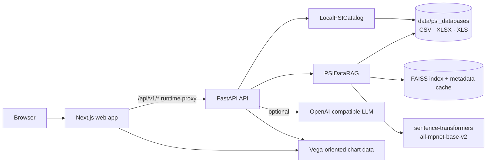

# ENIGMA / SAC — NASA PSI Combustion Research Workspace

> **Status:** working local-data prototype · **API version:** 1.0.0

ENIGMA / SAC is a web research workspace for the NASA Physical Sciences Informatics (PSI) Combustion Science collection. It turns a natural-language research question into:

1. **Semantic search** over locally stored NASA PSI investigation files.
2. **Grouped results** by PSI investigation, with file-format counts and a controlled “show more” list.
3. **Experiment-aware summaries** that explain the investigation, the selected file, and the likely meaning of its variables.
4. **Interactive charts** built from real CSV, XLSX, and XLS rows.
5. **A cited RAG chat assistant** that can use an optional OpenAI-compatible LLM.

The active application uses **real local NASA PSI data only**. It does not call a synthetic-data endpoint, does not require PostgreSQL in local mode, and does not generate substitute measurements.

---

## 1. What the application does

- The user describes a research interest, such as *microgravity flame temperature*.
- The API embeds the question and retrieves matching investigation and file metadata from a local FAISS index.
- The web page groups matches by investigation (for example, all files under **PSI-20** appear as one card).
- Initially, the page shows the three most relevant investigations and offers a button to show the rest.
- Selecting an investigation opens:
  - its real schema and metadata,
  - an evidence-based summary,
  - a chart explorer with a file selector for every data file in that investigation,
  - a follow-up research conversation.
- Charts and previews read the actual rows from `data/psi_databases`.

### Current data

`data/psi_databases` currently contains:

| Item | Count |
| --- | ---: |
| NASA PSI investigation directories | 26 |
| Investigation metadata files | 26 |
| Data files | 34 |
| CSV files | 28 |
| XLSX files | 5 |
| XLS files | 1 |
| Investigations that currently include data files | 10 |

The other investigations are represented by metadata for retrieval, but have no local data file and therefore no chartable dataset.

`data/synthetic` and the synthetic ingestion scripts are legacy artifacts. They are not used by the active local-data page or API routes.

---

## 2. Architecture



### Components

| Component | Location | Responsibility |
| --- | --- | --- |
| Web frontend | `apps/web` | Next.js 14 interface, grouped search results, Markdown summaries, chart explorer, chat |
| API | `services/api` | FastAPI routes, request logging, rate limiting, summary orchestration |
| Local catalog | `services/search/src/rag/local_catalog.py` | Read-only scanning of `data/psi_databases`, schema inference, previews, chart rows |
| Local RAG | `services/search/src/rag/psi_data_rag.py` | FAISS retrieval and semantic search over investigation/file documents |
| Embeddings | `sentence-transformers/all-mpnet-base-v2` | Local query and corpus embeddings |
| LLM | configurable | Optional summary generation and cited chat answers |
| Contracts | `packages/contracts` | Shared schemas and types |
| Infrastructure | `infra` | Dockerfiles and Compose definition |

### Runtime data flow

1. `LocalPSICatalog` scans `PSI-*/metadata.json` and supported data files.
2. `PSIDataRAG` creates or loads a FAISS index in the `rag_cache` volume.
3. `POST /api/v1/search` retrieves distinct local datasets with numeric columns.
4. The frontend groups those datasets by `psiId`.
5. Dataset, schema, preview, summary, chart, and chat requests all reference the same stable local dataset ID.

---

## 3. Repository layout

```text
.
├── apps/web/                     # Next.js frontend
│   ├── app/page.tsx              # Main research workspace
│   ├── app/dataset-chart-explorer.tsx
│   ├── app/api/v1/[...path]/     # Runtime API proxy
│   └── app/api/site-images/
├── services/api/                 # FastAPI application and tests
├── services/search/              # Local catalog, embeddings, and RAG
├── packages/contracts/           # Shared schemas and types
├── infra/
│   ├── Dockerfile.api
│   ├── Dockerfile.web
│   ├── docker-compose.yml
│   └── init-db/                  # Legacy database-mode schema
├── data/psi_databases/           # Real local NASA PSI files
├── scripts/                      # Setup, legacy, and verification scripts
├── .env.example                  # Non-secret configuration template
└── README.md
```

Additional service folders under `services/` contain legacy database-mode modules. They are not required for the active local-data workflow.

---

## 4. Quick start

### Requirements

- Docker and Docker Compose
- Node.js 20 or newer
- npm 10 or newer
- Approximately 4 GB memory available to the API container for the first FAISS index build

### 1. Configure the environment

```bash
cp .env.example .env
```

For an LLM-backed summary and chat, set an OpenAI-compatible provider in `.env`. A Groq example:

```bash
LLM_PROVIDER=groq
LLM_API_KEY=gsk_your_key
LLM_API_URL=https://api.groq.com/openai/v1
LLM_MODEL=qwen/qwen3.8-27b
```

Leave `LLM_API_KEY` empty to use retrieval-only answers. The application remains functional without an LLM key.

Never commit `.env`. It is ignored by Git and must contain real secrets only on your machine or in a secret store.

### 2. Start the API

Local mode does not need PostgreSQL, Redis, or the external embedding service. Start only the API container:

```bash
docker compose --env-file .env -f infra/docker-compose.yml \
  up -d --build --no-deps api
```

The API is available at:

```text
http://localhost:8000/api/v1
```

The first semantic search, summary, or chat request may need to download the embedding model and build the FAISS index. This can take several minutes. The index is persisted in the `rag_cache` Docker volume and reused when local files and the embedding model do not change.

### 3. Start the web app

For development:

```bash
npm ci
API_BACKEND_URL=http://127.0.0.1:8000 npm run dev:web
```

Open:

```text
http://localhost:3000
```

### 4. Optional: run both services as containers

The web image is a standalone Next.js production image and proxies `/api/v1/*` to `API_BACKEND_URL` at runtime.

```bash
docker compose --env-file .env -f infra/docker-compose.yml \
  up -d --build --no-deps api

docker compose --env-file .env -f infra/docker-compose.yml \
  up -d --build --no-deps web
```

The Compose web service uses `API_BACKEND_URL=http://api:8000`.

Do not run `npm run build --workspace @enigma-sac/web` while the development server is still using `apps/web/.next`; stop the development server first.

---

## 5. API reference (local mode)

All routes are mounted under `/api/v1`. The web frontend reaches them through its runtime proxy at `/api/v1/*`.

| Method | Route | Purpose |
| --- | --- | --- |
| `GET` | `/health` | Local catalog and RAG status |
| `GET` | `/health/ready` | Readiness probe |
| `GET` | `/health/live` | Liveness probe |
| `POST` | `/search` | Semantic search over local PSI files |
| `GET` | `/datasets/{datasetId}` | Public metadata and numeric columns |
| `GET` | `/datasets/{datasetId}/schema` | Inferred columns, types, and sampled statistics |
| `GET` | `/datasets/{datasetId}/preview` | Bounded real-row preview |
| `POST` | `/datasets/{datasetId}/summary` | Experiment-aware evidence summary |
| `POST` | `/charts/preview` | Validated chart data and chart specification |
| `POST` | `/chat/completions` | Cited local RAG chat, optionally LLM-backed |
| `GET` | `/chat/models` | Configured provider models or local retrieval model |

### Example: search

```bash
curl -X POST http://localhost:8000/api/v1/search \
  -H 'Content-Type: application/json' \
  -d '{
    "query": "microgravity flame temperature and oxygen measurements",
    "options": {"maxResults": 100}
  }'
```

### Example: preview a real file

```bash
curl 'http://localhost:8000/api/v1/datasets/psi-47-daft-flight-data-gmt053-xls/preview?limit=10'
```

### Example: chat

```bash
curl -X POST http://localhost:8000/api/v1/chat/completions \
  -H 'Content-Type: application/json' \
  -d '{
    "messages": [
      {
        "role": "user",
        "content": "Which local datasets measure flame temperature in microgravity?"
      }
    ]
  }'
```

---

## 6. Summaries and RAG behavior

### Experiment-aware summaries

`POST /api/v1/datasets/{id}/summary` combines:

1. Investigation metadata: objectives, approach, research area, subarea, and project setting.
2. The selected file's inferred schema and sampled statistics.
3. Related local files from the same investigation.
4. Up to two local FAISS RAG excerpts from that investigation.

The prompt asks the LLM to produce:

- the experiment context,
- what the selected file represents,
- an executive summary,
- a table of relevant variables and their likely roles,
- coverage,
- at most six concise findings,
- limitations and warnings.

Variable meanings are inferred from column names, values, statistics, and investigation context. The local PSI files do not include a formal variable dictionary or unit metadata, so inferred interpretations are explicitly labeled **Inferred** and the missing dictionary is listed as a limitation.

If the LLM is unavailable or rate-limited, the API falls back to a descriptive Markdown summary that still includes experiment context and the variable-dictionary limitation.

### Cited chat

The chat endpoint retrieves local context before generating an answer.

- Selected dataset/application context is cited as `[S]`.
- Retrieved local context is cited as `[1]`, `[2]`, etc.
- Every answer ends with a `Local NASA PSI sources:` list.
- If no LLM is configured or the provider fails, the endpoint returns the cited retrieval instead of fabricating an answer.

---

## 7. Configuration

Important variables from `.env.example`:

| Variable | Default | Purpose |
| --- | --- | --- |
| `DATA_SOURCE` | `local` | `local` uses real PSI files; `database` selects the legacy catalog |
| `PSI_DATA_DIR` | `data/psi_databases` | Local data directory on the host |
| `NASA_RAG_EMBEDDING_MODEL` | `sentence-transformers/all-mpnet-base-v2` | Local RAG embedding model |
| `NASA_RAG_TOP_K` | `5` | Retrieved chunks passed to chat |
| `LLM_PROVIDER` | `openai` | `openai` and `groq` use the OpenAI-compatible client |
| `LLM_API_KEY` | empty | Optional LLM key; empty means retrieval-only chat |
| `LLM_API_URL` | `https://api.openai.com/v1` | OpenAI-compatible base URL |
| `LLM_MODEL` | `gpt-4o-mini` | Default chat/summary model |
| `LLM_MAX_TOKENS` | `2000` | Maximum response length |
| `LLM_TEMPERATURE` | `0.1` | Lower values are more factual |
| `API_BACKEND_URL` | `http://127.0.0.1:8000` | Backend URL used by the web runtime proxy |

In Docker, the API container always uses `/app/data/psi_databases`; the host path is mounted read-only by Compose.

Groq's free tier can enforce low input-token-per-minute limits. If summary requests fall back because of rate limits, reduce `NASA_RAG_TOP_K`, use a shorter summary, or wait for the provider window to reset.

---

## 8. Testing and verification

### Backend tests

The API image does not include test-only dependencies by default. Run the current local-data regression tests inside the running API container with a temporary pytest install:

```bash
docker exec enigma-sac-api sh -c '
  pip install -q --target /tmp/pytest pytest==8.3.5 >/dev/null 2>&1;
  PYTHONPATH=/tmp/pytest python -m pytest -q \
    services/search/tests/test_local_catalog.py \
    services/api/tests/test_search_regression.py \
    services/api/tests/test_summary_markdown.py
'
```

The current core suite covers:

- real CSV preview, schema, and chart rows,
- Windows-1252 and mixed-value handling,
- investigations with metadata but no files,
- local search and chat route integration,
- RAG prompt grounding and citations,
- LLM fallback behavior,
- Markdown summary preservation,
- experiment context and variable-limitation reporting.

### Frontend checks

```bash
npx tsc --noEmit -p apps/web/tsconfig.json
```

For a production build, stop the development server first:

```bash
npm run build --workspace @enigma-sac/web
```

### Smoke tests

```bash
curl http://localhost:8000/api/v1/health

curl -X POST http://localhost:3000/api/v1/search \
  -H 'Content-Type: application/json' \
  -d '{"query":"microgravity flame temperature","options":{"maxResults":5}}'

curl 'http://localhost:3000/api/v1/datasets/psi-47-daft-flight-data-gmt053-xls/preview?limit=3'
```

---

## 9. Deployment recommendation for Azure

The recommended production target is **Azure Container Apps**.

### Why Container Apps

- The application is naturally two containers: a stateless Next.js web app and a stateful local-data API.
- Container Apps supports multiple applications in one environment, internal ingress for the API, and public HTTPS ingress for the web app.
- It supports secrets, health probes, custom domains, managed identity, and GitHub Actions deployment.
- The API needs enough memory for the FAISS index and can be kept warm with a minimum replica count.

### Recommended Azure setup

| Azure resource | Purpose |
| --- | --- |
| Azure Container Registry | Store versioned `enigma-sac-api` and `enigma-sac-web` images |
| Container Apps environment | Shared virtual network and internal service discovery |
| Container App: `api` | FastAPI, internal ingress, 4 GiB memory, 1–2 vCPU |
| Container App: `web` | Next.js standalone server, public ingress, 1 GiB memory |
| Azure Files share: `psi-data` | Mounted read-only at `/app/data/psi_databases` |
| Azure Files share: `rag-cache` | Persistent FAISS/Hugging Face cache at `/app/services/search/src/rag/.cache` |
| Key Vault or Container Apps secrets | `LLM_API_KEY` and other secrets |
| Managed identity | ACR image pull and Key Vault access without stored credentials |
| GitHub Actions | Build, test, push images, and deploy revisions |

### Deployment notes

- Set `DATA_SOURCE=local`.
- Set `API_BACKEND_URL` to the API's internal Container Apps URL.
- Keep the API minimum replica count at one to avoid cold starts and repeated index loading.
- Mount the same `rag-cache` Azure Files share on every API replica so the FAISS index is built once and reused.
- Use `/api/v1/health/live` for liveness and `/api/v1/health/ready` for readiness.
- The health endpoint reports the RAG index as lazy; the first search or chat request after a cold start may still take time to load it.
- Do not put the LLM key in image metadata or Git. Use Key Vault references or Container Apps secrets.
- Azure App Service for Containers is a simpler alternative, but Container Apps is a better fit for this two-service, volume-backed architecture.

---

## 10. Security and data-integrity rules

- Local NASA PSI data is mounted read-only in Compose.
- The active local routes never write to source files.
- Previews and charts are bounded by row and memory limits.
- LLM prompts must use provided metadata, statistics, and retrieved context only.
- Summaries and chats must not invent measurements, units, rows, or file contents.
- Variable interpretations without a source dictionary must be labeled as inferred.
- Real API keys belong only in `.env` locally or in a managed secret store.
- `.env`, `.env.*`, build outputs, caches, and dependencies are excluded from Git and Docker build context.

---

## 11. Known limitations

- The local PSI files do not include a formal variable dictionary or unit metadata.
- Only 10 of the 26 investigations currently include local data files.
- Schema types and statistics are inferred from bounded samples, not a externally certified data profile.
- The first FAISS build downloads an embedding model and can take several minutes.
- External LLM providers may rate-limit requests; the API falls back to local descriptive/cited behavior.
- The legacy database and synthetic pipeline is not part of the active local workflow and is not maintained as the primary path.
