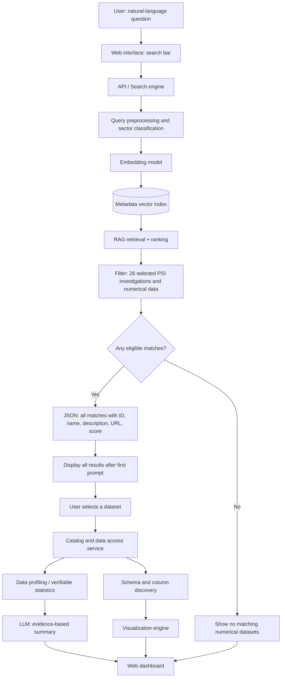

# Semantic Data Discovery & Interactive Dashboards

> **Status:** Architecture proposal · **Version:** 0.2.0 (planning)

A web application that turns natural-language questions into **dataset discovery**, **evidence-based summaries**, and **interactive visualizations**. At its core is a semantic search engine powered by embeddings and retrieval-augmented generation (RAG), which retrieves and ranks all relevant eligible datasets from a metadata catalog scoped to **NASA PSI — Combustion Science: 26 Selected Investigations**. Only datasets containing usable numerical measurements are eligible for analysis.

## 1. Overview

Users enter a question in a search bar. The system interprets the intent, searches a semantic index of dataset descriptions, and returns a JSON object containing **all matching, numerically usable datasets** (not only the top result), each with a name, description, source link, and metadata. The complete result list appears immediately after the first prompt; users can then select a dataset. This result enables two capabilities: an LLM-generated summary and a chart builder for selecting columns and creating visualizations. The web interface brings the entire workflow together.

### Main objective

Make data exploration accessible without requiring users to know the names, locations, or schemas of available data sources beforehand.

### MVP scope

- Search exclusively within **NASA PSI — Combustion Science: 26 Selected Investigations** using natural language.
- Include only datasets with usable numerical data; descriptive metadata remains available for discovery.
- Retrieve and rank results using semantic similarity.
- Return structured JSON containing **every qualifying match**, ranked by relevance, with names, descriptions, and source URLs.
- Summarize **verifiable metadata** and, when data is accessible, **statistics computed from the dataset**.
- Inspect columns and create interactive charts.
- Display results in a unified web application.

### Out of scope for the initial release

- Fully automated generation of complex, multi-source dashboards.
- Arbitrary joins across datasets.
- Unrestricted SQL queries generated and executed by the LLM.
- Training or fine-tuning foundation models.

## 2. Proposed Architecture



> **Note:** RAG retrieves **descriptions and metadata** to identify sources; it does not replace reading the actual dataset. Statistical summaries and charts require querying the underlying data through controlled connectors.

### Components

| Component | Responsibility |
|---|---|
| Frontend | Search, results, summaries, and interactive dashboards |
| Backend API | Orchestrates services and exposes endpoints |
| Data catalog | Stores identifiers, URLs, descriptions, sectors, schemas, and permissions |
| Sector classification engine | Classifies query intent, domain, and potential filters |
| Embedding service | Converts queries and descriptions into comparable vectors |
| Vector store | Indexes dataset embeddings |
| RAG retriever | Retrieves and ranks candidates; optionally uses a reranker |
| Data connectors | Access CSV, Parquet, APIs, or SQL databases with restricted permissions |
| Data profiling service | Computes statistics and validates types, missing values, units, and ranges |
| LLM service | Produces summaries based on metadata and observed facts |
| Chart engine | Validates columns and provides charts suited to their data types |

## 3. Project Phases

### Phase 1 — Semantic Search and Complete Numerical Dataset Discovery

**Objective:** transform the user's first natural-language prompt into a **complete, ranked list of matching numerical datasets** from the fixed collection **NASA PSI — Combustion Science: 26 Selected Investigations**. Display **every qualifying match**, with its **name, description, and link**, before a dataset is selected for the existing summarization and charting workflows.

**Source scope and numerical-only rule:**

- Search only the **26 preselected NASA PSI Combustion Science investigations**; the 26 investigations define the allowed search corpus, **not a guaranteed count of individual data files**.
- Index their descriptions, scientific objectives, approaches, experiment identifiers, and dataset metadata as **searchable text**. Text is used for retrieval only, not as analytical data.
- Include a dataset in the results only when its numerical content can be verified from its schema, a cataloged numerical-data indicator, or an authorized inspection of the actual source (e.g., numeric measurements in CSV, Parquet, or equivalent data tables).
- Exclude sources that contain only reports, images, explanatory text, or other nonnumerical artifacts. Do not assume that every PSI investigation provides a downloadable numerical dataset.
- Retain provenance: each dataset must reference its original PSI investigation and a verified source URL. An investigation page must not be misrepresented as a direct data-download URL.

**Workflow:**

1. The user enters the **first prompt** in the web search bar (for example, asking about combustion temperature or flame behavior).
2. The system normalizes the query and performs **sector/subtopic classification** within combustion science (e.g., flame dynamics, microgravity combustion, thermal measurements, or fluid behavior). This replaces unrestricted cross-domain classification.
3. The embedding service vectorizes the query.
4. The vector index searches the metadata catalog of the **26 selected PSI investigations and their associated numerical datasets**.
5. The RAG retriever gathers and ranks candidates by semantic relevance, optionally using metadata filters and reranking. Retrieval must **not be truncated to a displayed top-k**: pagination or exhaustive candidate collection must preserve all qualifying matches from the allowed catalog.
6. The system validates that each candidate belongs to the approved collection, has a usable numerical dataset, and has a valid, authorized URL. Remove duplicate references to the same dataset while preserving distinct datasets within an investigation.
7. Apply the configured relevance criteria and return **all eligible matches**, ordered by relevance. If none qualify, explicitly return an empty result list and a helpful no-match message; never invent a source or URL.
8. The API returns a JSON object with a `datasets` array and a `total_matches` count.
9. **Immediately after the first prompt**, the web interface displays **all returned datasets** in a scrollable/paginated results list. Each item visibly includes **dataset name, short description, source link**, and optionally PSI identifier, numerical columns, file format, and relevance score. UI pagination must not silently drop matches.
10. The user selects any one of the listed datasets. Its stable `dataset.id` feeds the already planned **Phase 2 (LLM summary)** and **Phase 3 (interactive chart builder)** without altering those phases.

**Example input:**

```text
Find numerical datasets about combustion temperature measurements in microgravity.
```

**Example response** (entirely illustrative placeholders; **not verified NASA PSI records or URLs**):

```json
{
  "query": "Find numerical datasets about combustion temperature measurements in microgravity.",
  "status": "matches_found",
  "source_collection": "NASA PSI — Combustion Science: 26 Selected Investigations",
  "data_filter": "numeric_only",
  "total_matches": 2,
  "datasets": [
    {
      "id": "example-psi-numeric-001",
      "psi_id": "PSI-EXAMPLE-A",
      "name": "Example combustion temperature measurements",
      "description": "Illustrative numerical temperature observations under reduced gravity.",
      "url": "https://example.org/illustrative/numeric-data-001.csv",
      "format": "csv",
      "numeric_columns": ["time_s", "temperature_k"],
      "score": 0.93
    },
    {
      "id": "example-psi-numeric-002",
      "psi_id": "PSI-EXAMPLE-B",
      "name": "Example flame sensor measurements",
      "description": "Illustrative time-series numerical observations of a flame experiment.",
      "url": "https://example.org/illustrative/numeric-data-002.csv",
      "format": "csv",
      "numeric_columns": ["time_s", "signal_v"],
      "score": 0.87
    }
  ]
}
```

For no qualifying matches, use `"status": "no_matches"`, `"total_matches": 0`, and `"datasets": []`. Scores above are illustrative and **are not probabilities**; their meaning depends on the retrieval method and calibration.

**First-prompt UI requirements:**

- Show the full set of qualifying results, not a single recommended dataset and not only a hidden list of alternatives.
- Provide each result's **name, description, and clickable verified link**, plus a control for selecting it.
- Display the number of matches and their source PSI investigation identifiers where available.
- Allow ranking, pagination, and filtering without discarding the underlying result set.
- Clearly distinguish **PSI investigation landing-page URLs** from **direct numerical dataset download URLs**.
- Keep the original downstream behavior: selecting a result enables the LLM summary and numerical column-based visualization.

**Deliverables:**

- Bounded metadata catalog and ingestion/indexing pipeline for the 26 selected PSI investigations.
- Numerical-dataset eligibility and URL validation rules.
- Embedding service and vector index.
- `POST /api/v1/search` returning a JSON array of **all** qualifying matches.
- Results UI showing all names, descriptions, and links after the first prompt.
- Validated JSON schema, deduplication, pagination, and no-match handling.
- Relevance tests using combustion-science evaluation queries.

**Acceptance criteria:**

- Search results originate exclusively from the 26 selected NASA PSI Combustion Science investigations.
- All returned datasets have verifiable numerical content; textual metadata is permitted only for discovery and explanation.
- **Every qualifying result** is included in the JSON array and accessible in the UI, with name, description, and valid URL.
- `total_matches` equals the number of returned distinct datasets, regardless of UI pagination.
- No result URL is fabricated; all references are traceable to source metadata and comply with access policies.
- When no eligible dataset is found, the API returns an empty list and communicates the reason without inventing alternatives.
- Selecting a dataset passes its `dataset.id` into the existing summarization and visualization flows.

### Phase 2 — LLM-Based Summarization

**Objective:** provide users with a concise, useful explanation of the selected dataset.

**Workflow:**

1. Receive the `dataset.id` from Phase 1.
2. Retrieve metadata (description, temporal/geographic coverage, variables, provenance, update frequency, and limitations).
3. If the source is accessible, compute a reproducible profile: row count, columns, missing values, ranges, and relevant statistics.
4. Supply only these verifiable facts to the LLM to generate a summary.
5. Return the text with source references and warnings about missing information.

**Expected output:** title, executive description, relevant variables, coverage, findings supported by calculations, and limitations. If only the URL is available, generate a **descriptive summary**, not fabricated statistical conclusions.

**Deliverables:** `POST /api/v1/datasets/{id}/summary` service, prompt template, factual-content validation, and source traceability.

**Acceptance criteria:** the summary clearly distinguishes metadata, computed statistics, and unavailable information; it never attributes unsupported figures to the dataset.

### Phase 3 — Interactive Chart Builder

**Objective:** select variables from the retrieved dataset and create exploratory charts.

**Workflow:**

1. Receive the same `dataset.id` generated in Phase 1.
2. Access the dataset through a validated connector.
3. Detect its schema, column names, and types (`numeric`, `categorical`, `datetime`, etc.).
4. Display column selectors for the X-axis, Y-axis, grouping, and filters.
5. Validate compatibility between data types and chart types.
6. Render the chart and allow users to adjust parameters without repeating the search.

**Initial chart types:** bar, line, scatter, and histogram; expand based on use cases.

**Deliverables:** `GET /api/v1/datasets/{id}/schema` API, `POST /api/v1/charts/preview` API, column selection controls, and charts with loading/error states.

**Acceptance criteria:** displayed columns belong to the selected dataset; charts are computed from real data; missing values, high cardinality, pagination, and size limits are handled.

### Phase 4 — Web Application and Integration

**Objective:** combine the previous phases into a consistent user experience.

**Interface sections:**

- **Home:** search bar and example questions.
- **Results:** all matching numerical datasets, each with name, description, URL, similarity, and provenance; selectable for the next steps.
- **Summary:** LLM-generated description with limitations and sources.
- **Explorer:** data preview, schema, selectors, filters, and charts.
- **Dashboard:** layout of selected visualizations and interactive controls.

**Required states:** search in progress, no matches, unavailable source, data-reading error, summary pending, and invalid chart.

**Deliverables:** responsive frontend, API integration, state management, end-to-end tests, deployment, and user documentation.

**Acceptance criteria:** a user can move from a question to a dataset, review its summary, and generate at least one chart without leaving the application.

## 4. Proposed Data Contracts and Endpoints

| Method | Route | Purpose |
|---|---|---|
| `POST` | `/api/v1/search` | Classify, vectorize, and retrieve all qualifying numerical PSI datasets |
| `GET` | `/api/v1/datasets/{id}` | Retrieve source metadata |
| `GET` | `/api/v1/datasets/{id}/schema` | Return columns and data types |
| `GET` | `/api/v1/datasets/{id}/preview` | Return a bounded sample of records |
| `POST` | `/api/v1/datasets/{id}/summary` | Generate an evidence-based summary |
| `POST` | `/api/v1/charts/preview` | Generate the chart specification and/or data |

**Integration principle:** Phase 1 returns multiple items in `datasets[]`; after selection, Phases 2 and 3 use the selected `dataset.id` as a stable reference. The URL is output information and **must not** be accepted as an arbitrary address for the server to download without validation.

## 5. Minimum Catalog Data Model

| Field | Description |
|---|---|
| `id` | Unique, stable identifier |
| `name` | Dataset name |
| `description` | Descriptive summary for semantic search |
| `sector` / `tags` | Domain and topical tags |
| `url` | Authorized resource reference |
| `format` | CSV, Parquet, API, SQL, etc. |
| `schema` | Columns, types, descriptions, and units, when available |
| `source` / `license` | Provenance and usage license |
| `coverage` | Temporal and geographic scope |
| `updated_at` | Metadata update timestamp |
| `access_policy` | Access and permission rules |
| `embedding` | Vector computed from the descriptive record |

**Indexing:** when metadata is added or updated, recompute its embedding and update the index. Track the embedding model version to support reindexing.

## 6. Suggested Technology Stack (Optional)

| Layer | Proposed option | Rationale |
|---|---|---|
| Frontend | Next.js + React + TypeScript | Modular interface and interactive components |
| Backend | Python + FastAPI | APIs and data science ecosystem |
| Catalog / vectors | PostgreSQL + pgvector | Metadata and vector similarity in one database |
| Embeddings | Replaceable multilingual model | Meaning-based retrieval |
| RAG | Custom implementation or LlamaIndex/LangChain | Retrieval, filtering, and reranking |
| Summaries | Configurable LLM provider | Model and cost flexibility |
| Data profiling | Pandas or Polars | Statistics and file reading |
| Visualizations | Plotly.js or Apache ECharts | Interactive charts |
| Deployment | Docker Compose | Reproducible MVP environment |

Final technology choices should be validated against source formats, dataset count, data volume, latency requirements, and available resources.

## 7. Suggested Repository Structure

```text
.
├── README.md
├── docs/
│   ├── architecture.md
│   ├── api-contracts.md
│   ├── data-catalog.md
│   └── decisions/
├── apps/
│   └── web/                    # Frontend
├── services/
│   ├── api/                    # HTTP orchestration
│   ├── search/                 # Sector classification, embeddings, RAG
│   ├── catalog/                # Metadata and connectors
│   ├── summarizer/             # Profiling + LLM prompts
│   └── visualization/          # Chart validation and data
├── packages/
│   └── contracts/              # JSON schemas / shared types
├── data/
│   └── samples/                # Non-sensitive test data
├── scripts/
│   └── ingest_catalog.py
├── tests/
│   ├── unit/
│   ├── integration/
│   ├── retrieval_eval/
│   └── e2e/
├── infra/
│   └── docker-compose.yml
└── .env.example                # Variable names only; no secrets
```

> This service-based breakdown represents logical responsibilities. For an MVP, these can be implemented as modules within a **modular monolith** and separated later if scale requires it.

## 8. Security, Quality, and Observability

- **Allowlisted data connectors:** prevent SSRF, block unexpected local or private URLs, and never download user-provided URLs directly.
- **Permissions and secrets:** store credentials in environment variables or a secrets manager; use read-only access where appropriate.
- **Prompt injection protection:** treat metadata and dataset content as untrusted information, never as instructions for the LLM.
- **Data controls:** enforce row, memory, and time limits; sanitize previews; respect licenses and privacy policies.
- **Reproducibility:** record catalog version, embedding model, query, candidates, scores, and the source used for each summary or chart.
- **Evaluation:** measure `Recall@k` / `MRR` for search, factual faithfulness for summaries, and type correctness for charts.
- **Operations:** structured logs, latency/error/cost metrics, and data-source availability monitoring.

## 9. Implementation Roadmap

| Milestone | Verifiable outcome | Dependency |
|---|---|---|
| M0 — Foundations | Initial catalog, test dataset, and API contracts | None |
| M1 — Phase 1 | Query → RAG → all matching numerical PSI datasets in JSON and results UI | M0 |
| M2 — Phase 2 | JSON → profiling → traceable summary | M1 |
| M3 — Phase 3 | JSON → schema → interactive chart | M1 |
| M4 — Phase 4 | Integrated web interface and MVP deployment | M2 and M3 |

Phases 2 and 3 can be developed **in parallel** once the Phase 1 contract is stable.

## 10. Next Steps

1. Catalog the 26 selected NASA PSI Combustion Science investigations and verify their available numerical datasets, descriptions, URLs, columns, and permissions.
2. Specify the **combustion science subtopic classification** taxonomy and design 20–50 evaluation questions.
3. Decide which formats the MVP will support (for example, CSV and Parquet).
4. Implement the catalog schema, ingestion, and `POST /api/v1/search`.
5. Establish the stable `dataset.id` contract for summarization and chart generation.
6. Build Phases 2 and 3, followed by the integrated web interface.

## 11. Project Status

- [ ] Catalog and test data sources
- [ ] Phase 1: semantic search + RAG + complete numerical-results JSON and UI
- [ ] Phase 2: LLM summary with verifiable evidence
- [ ] Phase 3: column selection and charts
- [ ] Phase 4: integrated web interface
- [ ] Testing, documentation, and deployment

---

**Note:** Names, API routes, JSON values, tools, and example URLs are initial proposals subject to validation during technical design.
